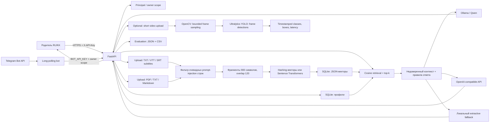

# Архитектура

## Поток данных

1. Ключ API разрешается в principal. Обычный principal видит только свои профили и документы; отдельный секрет Telegram-бота может передать `X-Owner-ID`, который сервер выставляет по доверенному Telegram user ID.
2. Upload читает файл в пределах конфигурируемого лимита, извлекает текст и сохраняет только извлечённый очищенный текст. Разрешены PDF, TXT и Markdown. PDF имеет также лимит числа страниц.
3. Индексация делит текст на фрагменты с перекрытием и сохраняет векторы в SQLite. По умолчанию векторизация хеширует слова и символьные n-граммы, добавляя небольшой RU/KK словарь понятий. Это переносимый демонстрационный fallback, а не качество полноценной мультиязычной модели. Sentence Transformers включаются конфигурацией.
4. Поиск вычисляет cosine similarity в Python, фильтрует ниже порога, слегка повышает score источника на языке вопроса и возвращает документ и chunk для ссылки. При наличии профиля возраст, интересы, материалы и предпочтения добавляются к контексту генерации и слегка влияют на ранжирование; медицинских или developmental выводов по ним нет.
5. Генератор настраивается как Ollama, OpenAI-compatible endpoint или детерминированное извлечение фрагмента. Если внешний генератор не отвечает, используется extractive fallback. При отсутствии релевантных фрагментов ответ воздерживается.
6. Видеообработчик ставится отдельно. Он читает временный файл, проверяет метаданные и лимиты, извлекает до заданного числа кадров, вызывает YOLO и удаляет исходный файл после ответа. В RAG попадают только отдельно загруженные TXT/VTT/SRT-субтитры; исходное видео и кадры не сохраняются.

## Границы прототипа

- Встроенный поиск предназначен для маленькой демонстрационной базы. Для большого индекса нужен отдельный vector store/ANN-индекс и миграция хранения.
- SQLite не шифрует файлы базы данных. В демонстрации используйте синтетические данные. При выборе внешнего LLM-провайдера retrieved text и поля профиля уходят этому провайдеру; до production нужны утверждённое хранение/retention, секрет-хранилище, аудит доступа и privacy review.
- Фильтр prompt injection основан на эвристиках и не гарантирует обнаружение всех атак. Не передавайте retrieved context модели как доверенные инструкции.
- YOLO-модуль — демонстрационный детектор объектов общего назначения. Результаты не описывают действия ребёнка, этапы развития, эмоции или риски; целевые классы не размечались и метрики не измерялись. У Ultralytics есть лицензии AGPL-3.0 и Enterprise; перед коммерческим распространением проверьте условия выбранного способа использования.
- Видео поступает в API как недоверенный бинарный ввод. Перед публичным production-развёртыванием нужна изолированная очередь обработки, ограничения частоты/параллелизма, лимит тела запроса на reverse proxy и проверка кодеков.
- Встроенная language detection определяет казахский по уникальным буквам и иначе использует русский/предпочтительный язык. Это не полноценный классификатор для любых смешанных запросов.
- В API не сохраняются вопросы и ответы. Профили сохраняются в SQLite; файл можно удалить вместе с базой в локальном демо.
